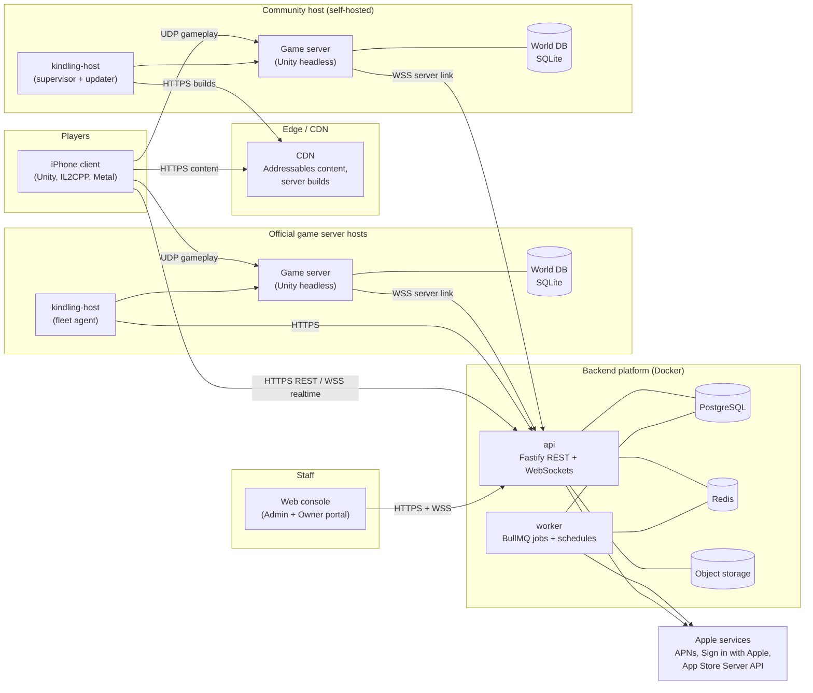
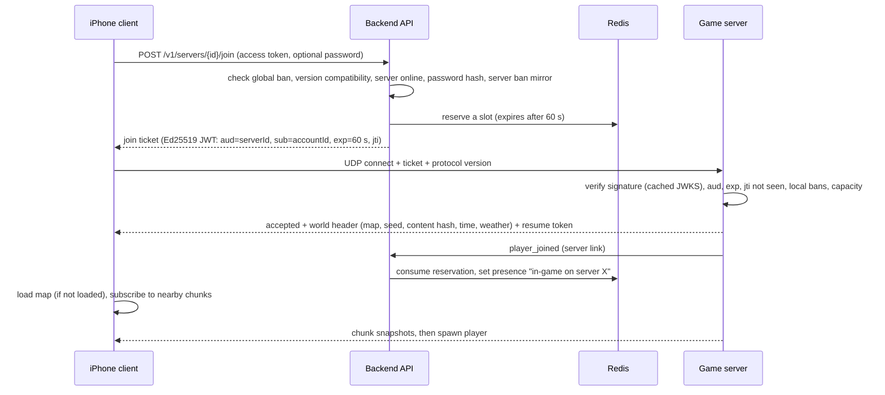

# 03 — System Architecture

## 1. Ecosystem overview

## 2. Components and responsibilities

| Component | Responsibilities | Is NOT responsible for |
|-----------|------------------|------------------------|
| **iPhone client** | Input, rendering, audio, UI, prediction of the local player, interpolation of others, content download, account UI, server browser | Deciding outcomes. Every gameplay result comes from the server |
| **Game server** (Unity headless) | Authoritative simulation at 30 Hz: movement validation, combat, gathering, crafting, building, inventories, AI, weather/time, persistence to its world DB, interest management, anti-cheat checks, chat filtering | Accounts, global bans, entitlements, matchmaking |
| **kindling-host** | Runs the game server process. Restarts, updates (download + verify signature), log tailing, local health checks. In *fleet mode* it manages several servers on one host | Gameplay |
| **api** | REST + WebSocket endpoints: auth, profiles, social, server registry and browser, join tickets, matchmaking, moderation, live ops, versions, content, entitlements, analytics ingestion, admin endpoints, the server link hub | Running gameplay simulation |
| **worker** | Background jobs: emails, push notifications, analytics rollups, stats aggregation, account deletions, cleanup, scheduled live-ops changes (events start/end), reachability probes for community servers | Serving requests |
| **PostgreSQL** | Long-lived source of truth for platform data | World state |
| **Redis** | Short-lived and fast state: presence, live server index, reservations, rate limits, queues, pub/sub | Long-lived source of truth (anything here can be rebuilt) |
| **Object storage + CDN** | Server builds, Addressables bundles, backups | |
| **Web console** | Staff administration (RBAC) and server-owner management | Direct database access (all access goes through the API) |

## 3. Trust boundaries

| Actor | Trust level | Consequences |
|-------|-------------|--------------|
| Client app | **Untrusted** | Sends only inputs and intents. Every intent is validated (distance, line of sight, permissions, cooldowns, inventory contents). App Attest at login raises the bar for modified clients but is never relied on |
| Community game server | **Trusted only for its own world** | Can't mint join tickets. Never receives emails, IPs from other servers or private profile data. Its stat reports are labeled *community* and kept out of global leaderboards. It can't grant account-level entitlements. Its build may have been modified, so the backend checks everything it sends |
| Official game server | Trusted | Runs on our hosts with our build. Its stats count for global leaderboards and seasonal challenges |
| Staff web console | Trusted after authentication + TOTP, limited by RBAC | Every change is audited. Dangerous actions require step-up re-authentication |
| Backend | Root of trust for identity | Holds the signing keys for join tickets and server builds (keys kept in the secret store, rotated) |

## 4. Data ownership

| Data | Authority | Stored in | Survives a wipe? |
|------|-----------|-----------|-----------------|
| Account, credentials, devices | Backend | PostgreSQL | Yes |
| Profile, cosmetics loadout, settings, HUD layout ("cloud save") | Backend | PostgreSQL (`cloud_saves`) | Yes |
| Cosmetic entitlements, purchases | Backend (validated with Apple) | PostgreSQL | Yes |
| Account level, seasonal challenge progress | Backend (from official server reports) | PostgreSQL | Yes |
| Lifetime stats | Backend (official vs. community scopes) | PostgreSQL | Yes |
| Friends, blocks, presence | Backend | PostgreSQL / Redis | Yes / ephemeral |
| Global sanctions (bans, mutes) | Backend | PostgreSQL | Yes |
| Server registry and settings metadata | Backend (owner-edited) | PostgreSQL | Yes |
| Server-level bans and staff | Game server, mirrored to the backend | World DB + PostgreSQL | Yes |
| **Character state on a server** (position, stats, inventory, knowledge) | **Game server** | World DB (SQLite) | No (wipes per server rules) |
| **World entities** (buildings, deployables, containers, items, claims) | **Game server** | World DB (SQLite) | No |
| Live server state (players, tick time) | Game server → backend | Redis (TTL) | Ephemeral |
| Analytics events | Backend | PostgreSQL (partitioned) | n/a |
| Audit log | Backend | PostgreSQL (append-only) | n/a |

**"Persistent inventory", stated precisely:** in-world inventories live on each game server and persist
across restarts until that server wipes, which is how wipe-based survival games work. Account-level
items (cosmetics, seasonal rewards) persist forever in the backend and appear on every server.

## 5. Key flows

### 5.1 App launch (bootstrap)
1. The client calls `GET /v1/bootstrap` with `X-Client-Version`, `X-Build`, `X-Protocol` and
   `X-Content-Version` headers.
2. The response holds: version status (`ok` / `update_available` / `update_required` with the App Store
   URL), maintenance state and message, announcements, the remote config snapshot plus its version,
   the active season, the content catalog URL and the server time.
3. If an update is required, the client shows a blocking screen with an App Store button. If the
   backend is in maintenance, the client shows the maintenance message and polls.
4. If seasonal content is missing, the client downloads it through Addressables (asking first on
   cellular for anything over 50 MB).

### 5.2 Login
`POST /v1/auth/apple` or `/v1/auth/login` (+ an App Attest assertion when available) → access token
(EdDSA JWT, 15 min) + rotating refresh token (opaque, 60 days, stored hashed) → client opens the
`WSS /v1/realtime` connection for presence and notifications.

### 5.3 Join a server

### 5.4 Gameplay tick (server, 30 Hz)
Receive inputs → simulate players (movement validation) → process intents (interact, craft, build,
attack) → simulate projectiles, AI, physics props → apply damage and deaths → survival stat updates
(1 Hz) → interest management → send state (player snapshots + chunk deltas + inventory deltas; ADR 0007) → mark
changed entities dirty for saving.

### 5.5 Saving
Every 60 s: dirty entities are serialized on the main thread into buffers (fast) → a background thread
writes them to SQLite in one transaction. A full checkpoint runs every 30 min, and a full save on
graceful shutdown. On player disconnect, that character is flushed right away. Hourly backups use the
SQLite online backup API → object storage (official) or a local `backups/` folder (community).

### 5.6 Interruptions (mobile)
The app goes to the background (call, notification, app switch) → the client sends `going_background`
→ the server keeps the character in place (sleeper rules apply after the grace period) → when the app
comes back within **120 s**, the client reconnects with its **resume token** (no new ticket needed).
After that, the client asks the backend for a new ticket and rejoins automatically.

### 5.7 Admin action (e.g. remove an item from a player's inventory)
Web console → `POST /admin/v1/servers/{sid}/players/{aid}/inventory/ops` (permission
`players.inventory.write`, step-up, reason required) → API writes an audit record → publishes the
command on Redis channel `srvcmd:{sid}` → the API node holding that server's link forwards it →
the game server validates and applies it, then replies → the API returns the result, and the audit
record is completed with the outcome.

### 5.8 Community server registration
The owner creates a server in the Owner Portal → gets a **server token** (shown once) → puts it in
`server-config.json` or the `KINDLING_SERVER_TOKEN` env var → the server opens the server link and
sends `hello` (version, ports, config summary, password hash) → the backend reachability probe sends a
UDP query to the public host:port → the server is listed in the browser (`community`, unverified).
Staff can mark servers *verified* or delist them.

## 6. Environments

| Environment | Purpose | Backend | Game servers | Client build |
|-------------|---------|---------|--------------|--------------|
| `local` | Development | Docker Compose on the dev machine | Unity Editor (host or server mode) or a local headless build | Editor / dev build |
| `dev` | Shared integration | 1 small VM | 1 headless server | Development builds via TestFlight internal |
| `staging` | Release candidate checks, load tests | Production-like, smaller | 1–3 servers + bot fleet | TestFlight internal |
| `production` | Live | HA as needed | Official fleet + community | App Store + external TestFlight (beta flag) |

The client picks its environment at build time (a build profile), never through a runtime switch the
user can reach. Staging and production use separate signing keys, databases and buckets.

## 7. Scaling model

- **Gameplay** scales by adding game servers (each one self-contained at about 50 players).
- **API** is stateless: run N replicas behind Caddy or a load balancer. WebSocket fan-out uses Redis
  pub/sub, with sticky routing only for in-flight requests.
- **PostgreSQL:** one primary + PITR backups. Read replica(s) for analytics and admin dashboards when
  needed. PgBouncer once connections grow.
- **Redis:** one primary with persistence (AOF) at first. Everything in Redis can be rebuilt from
  heartbeats and PostgreSQL.
- Rough capacity at the start: one 4 vCPU / 8 GB VM runs the whole backend for thousands of concurrent
  players, because gameplay traffic never touches it. We'll measure this in M10 load tests.
